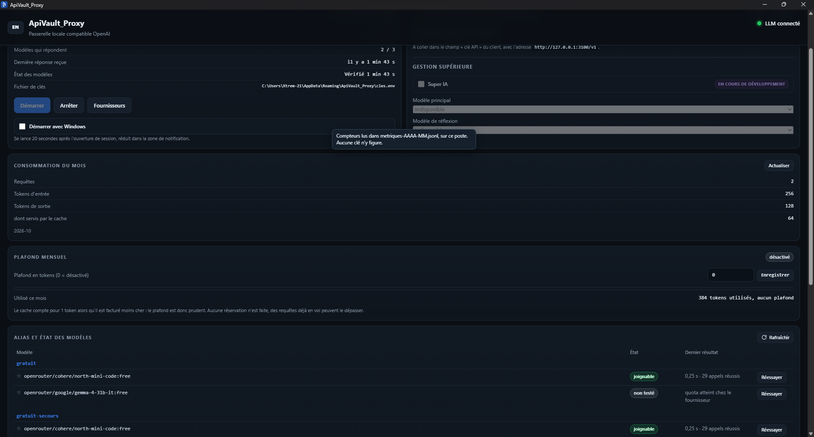
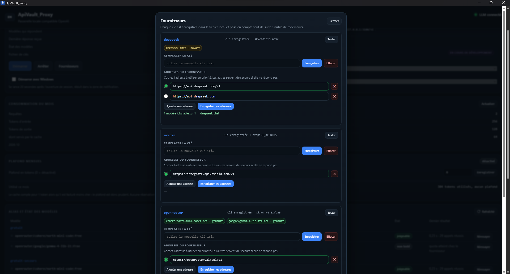
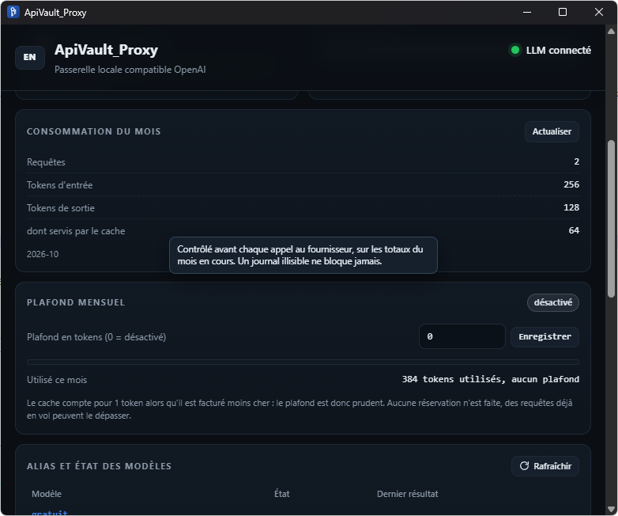
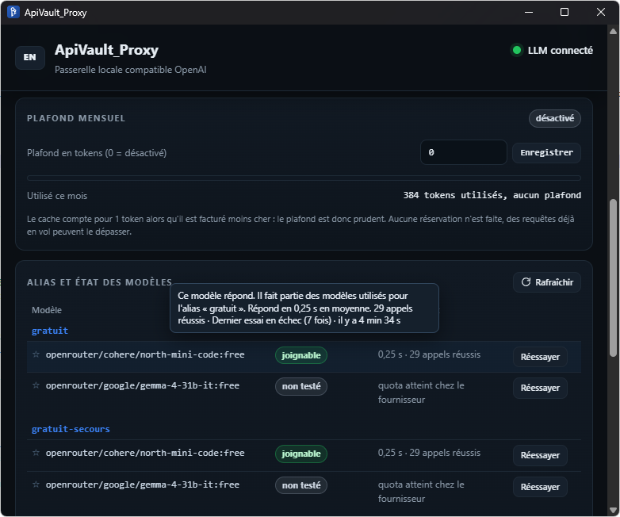
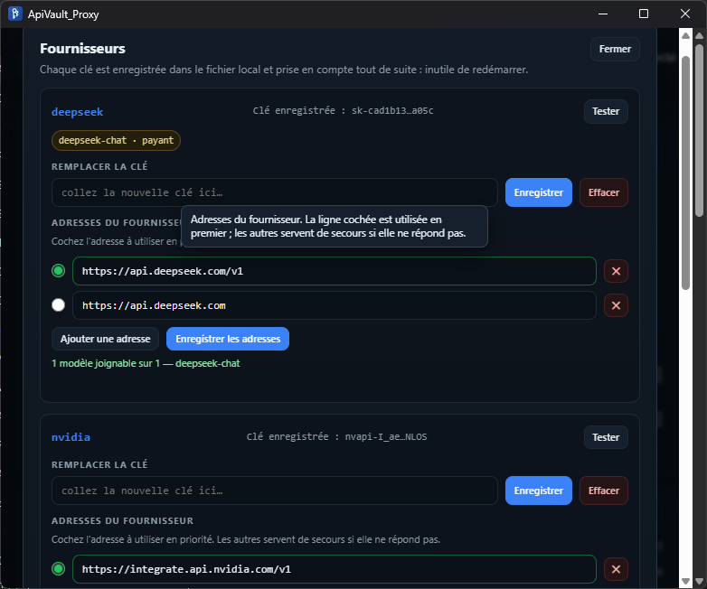
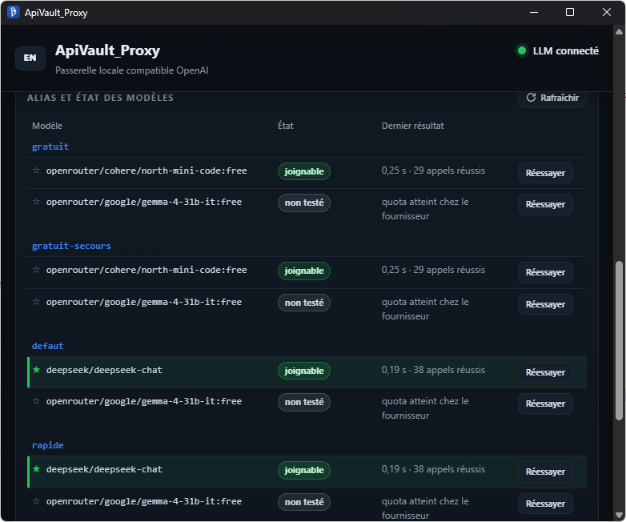

# ApiVault Proxy

[Français](README.md) | [English](README.en.md)

**Une passerelle locale, compatible OpenAI, qui garde tes clés d'API sur ta machine.**

ApiVault Proxy tourne en arrière-plan sur Windows, écoute uniquement sur
`127.0.0.1:3100`, et présente à tes outils une adresse unique :

```
base_url = http://127.0.0.1:3100/v1
```

Tu branches un client, un agent, une extension ou un script, et tu ne touches plus
jamais à une clé d'API dans ce client. Les clés vivent dans un coffre chiffré sur
ton disque. Le proxy choisit le modèle, bascule si un fournisseur ne répond pas,
compte ce que tu consommes et peut couper net à un plafond que tu fixes.

Pas de Docker, pas de Python, pas de Node, pas de service système. Un exécutable.

---

## Captures

| | |
|:--:|:--:|
|  |  |
| **La fenêtre de contrôle** — état du service, modèles joignables, jeton | **Gestion** — clés, adresses, test par fournisseur |
|  |  |
| **Consommation du mois** — entrée, sortie, cache, requêtes estimées | **Plafond mensuel** — jauge et alerte à 80 % |
|  |  |
| **Badges** — gratuit / payant, modèle par défaut | **États** — joignable, en attente, en panne |

> Les captures vivent dans [`docs/captures/`](docs/captures/). Voir le
> [guide de capture](docs/captures/LISEZ-MOI.md).

---

## Ce que ça fait

- **Un seul point d'entrée** — `http://127.0.0.1:3100/v1`, compatible OpenAI.
- **Coffre chiffré** — `cles.env` est chiffré au repos avec DPAPI (portée
  utilisateur Windows). Une sauvegarde `.bak` chiffrée est conservée avant chaque
  modification. Aucune clé en clair sur le disque.
- **Pool de fournisseurs** — plusieurs fournisseurs et plusieurs modèles, un alias
  `defaut` qui essaie les cibles dans l'ordre, bascule automatique en cas d'erreur.
- **États persistants** — une cible qui échoue passe en pause ou en panne, l'état
  survit au redémarrage, et rien n'est payé inutilement en boucle.
- **Compteur de tokens** — entrée, sortie et cache, par requête, agrégés par jour,
  semaine et mois. Un journal mensuel en ajout seul (`metriques-AAAA-MM.jsonl`).
  Des tokens, **jamais des euros** : la facturation reste chez le fournisseur, seul
  à connaître ses prix. Un montant calculé ici ne serait qu'une hypothèse.
- **Plafond mensuel** — vérifié **avant** l'appel au fournisseur, refus en `429`
  `plafond_atteint`, alerte à 80 %. Désactivé par défaut. Le refus dit combien a
  été consommé, sur combien, et quand le quota repart.
- **Port occupé** — si 3100 est pris, la passerelle bascule sur 3101, 3102… et
  retient le port choisi. Une bulle Windows prévient, et l'adresse est rappelée
  dans la fenêtre pour ne pas laisser un client pointer dans le vide.
- **Fournisseurs locaux** — option décochée par défaut pour autoriser le `http://`
  non chiffré vers une adresse privée (réseau local, Tailscale). Jamais vers
  Internet : sans chiffrement, la clé circulerait en clair.
- **Interface FR / EN**, infobulles, démarrage avec Windows, icône de notification
  qui change de couleur selon l'état réel.
- **Rien ne sort** — le service n'écoute que sur la boucle locale. Le seul appel
  sortant est la vérification de version, facultative, sans jeton et sans donnée
  envoyée.

---

## Démarrage rapide

1. Télécharge l'archive de la [dernière version](../../releases/latest) et
   décompresse-la où tu veux.
2. Lance `Demarrer.bat`. La fenêtre de contrôle s'ouvre ; le service démarre.
3. Dans **Gestion**, saisis ta première clé d'API. Elle est écrite chiffrée dans
   `cles.env`, appliquée immédiatement, sans redémarrage.
4. Clique sur **Copier la configuration client** : l'adresse, le jeton et le modèle
   par défaut partent dans le presse-papiers.
5. Colle ça dans ton client IA, à la place de l'adresse du fournisseur.

| Fichier | Rôle |
|---|---|
| `Demarrer.bat` | démarre la passerelle et ouvre la fenêtre |
| `Etat.bat` | vérifie le service, le jeton et les alias |
| `Rafraichir.bat` | réinterroge tous les fournisseurs |
| `Changer-Cle.bat` | remplace une clé hors de l'interface |
| `Arreter.bat` | arrête la passerelle |
| `Autostart-Activer.bat` | lancement discret à l'ouverture de session |

Fermer la fenêtre n'arrête pas le service : il continue en arrière-plan.

---

## API

Jeton obligatoire sur `/admin/*`, fourni en `Authorization: Bearer <jeton>`
(la valeur est la ligne `PROXY_MASTER_KEY` de `cles.env`).

| Route | Méthode | Rôle |
|---|---|---|
| `/health` | GET | état du service et version, sans jeton |
| `/v1/models`, `/models` | GET | alias disponibles, format OpenAI |
| `/v1/models/{id}` | GET | détail d'un alias |
| `/v1/chat/completions` | POST | relais, flux SSE ou réponse complète |
| `/admin/pool` | GET | état détaillé des alias et des cibles |
| `/admin/metriques` | GET | consommation de la période et plafond |
| `/admin/rafraichir` | POST | remise à zéro puis interrogation réelle |
| `/admin/requalifier` | POST | remise à zéro seule, tout ou une cible |

---

## Ce que le coffre protège — et ce qu'il ne protège pas

**Il protège contre :** un autre compte Windows sur la même machine, un disque
volé ou copié, une sauvegarde qui traîne, un fichier `cles.env` lu par erreur
(il est chiffré), un client IA qui garderait ta clé en clair dans son fichier de
configuration.

**Il ne protège pas contre :** un programme qui tourne **sous ton propre compte
Windows** — DPAPI le laisserait déchiffrer le fichier. Un accès administrateur
complet à ta session, un keylogger, ou une machine déjà compromise ne sont pas
couverts.

C'est un choix assumé : pas de mot de passe maître à taper à chaque démarrage,
donc pas de friction, mais une protection qui s'arrête à la frontière de ta
session Windows.

Le service n'écoute que sur `127.0.0.1`. Il vérifie l'en-tête `Host` pour se
protéger du DNS rebinding, et refuse les requêtes sans jeton sur l'administration.

---

## Compteur et plafond

Chaque requête relayée écrit **une ligne** dans
`%APPDATA%\ApiVault_Proxy\metriques-AAAA-MM.jsonl` :

```json
{"horodatage":1760800000,"alias":"defaut","cible":"deepseek","modele":"deepseek-chat",
 "tokens_in":1240,"tokens_out":318,"cache":0,"estime":false,"flux":true,"statut":200}
```

Le journal est en **ajout seul** : aucun compteur n'est remis à zéro, les vues
jour / semaine / mois sont des agrégations du même fichier.

Quand un fournisseur n'envoie pas son décompte (fréquent en flux), la ligne est
marquée `"estime": true` et les tokens sont estimés à partir des octets réels.
L'interface le signale. Un compteur à zéro serait un mensonge ; une estimation
signalée ne l'est pas.

Le plafond est global et mensuel, exprimé en tokens (`PROXY_PLAFOND_MENSUEL`).
Il est vérifié avant l'appel amont. S'il est atteint, la requête est refusée en
`429` avec le code `plafond_atteint`, sans aucun appel au fournisseur.

---

## Tests

```powershell
cd Proxy-Externe\src-tauri
cargo test
```

**88 tests** : 30 unitaires et 58 d'intégration. Aucun ne touche à une vraie clé :
les tests utilisent des valeurs factices et des faux fournisseurs locaux.

Où trouver quoi :

| Document | Contenu |
|---|---|
| [`docs/tests/INVENTAIRE.md`](docs/tests/INVENTAIRE.md) | les 88 tests, quel test prouve quoi, et ce que rien ne couvre |
| [`docs/tests/RECETTE-INTERNE.md`](docs/tests/RECETTE-INTERNE.md) | 9 contrôles sur le binaire réel, bac à sable et faux fournisseur |
| [`PROTOCOLE-TEST-UTILISATEUR.md`](PROTOCOLE-TEST-UTILISATEUR.md) | la recette pas à pas, 42 étapes, rejouable par n'importe qui |
| [`PROTOCOLE-TEST.md`](PROTOCOLE-TEST.md) | la charte d'un audit externe, méthode J0 à J6 |

---

## Structure

```
ApiVault_Proxy/
├── Proxy-Externe/          la passerelle (Rust) et son interface (Tauri 2)
│   ├── src/index.html      interface de contrôle, FR / EN
│   ├── src-tauri/src/      serveur, pool, coffre, métriques, configuration
│   ├── src-tauri/tests/    suites d'intégration et de sécurité
│   └── *.bat               lancement, état, arrêt, clé, démarrage auto
├── docs/captures/          captures d'écran
├── ETAT-REEL.md            ce qui existe vraiment, sans promesse
├── SPECIFICATION.md        spécification d'origine (document d'intention)
└── PROTOCOLE-TEST-UTILISATEUR.md
```

---

## Ce qui n'est pas encore là

Dit franchement, pour que personne ne le découvre après installation :

- pas de mot de passe maître : la protection s'arrête à ta session Windows ;
- pas de quotas par alias ni de prix en euros — seul le plafond global existe ;
- pas d'API Anthropic (`/v1/messages`) ni d'`/v1/embeddings` ;
- pas d'apprentissage automatique des modèles équivalents ;
- pas de zeroize des clés en mémoire (limite assumée, protection à la frontière de session) ;
- la Super IA n'est pas là.

La spécification d'origine décrit l'intention ; deux points ont évolué en cours
de route (le coffre utilise DPAPI et non PBKDF2/AES, l'audio n'est pas
implémenté). [`ETAT-REEL.md`](ETAT-REEL.md) est la référence factuelle.

---

## Licence

MIT — voir [LICENSE](LICENSE).
